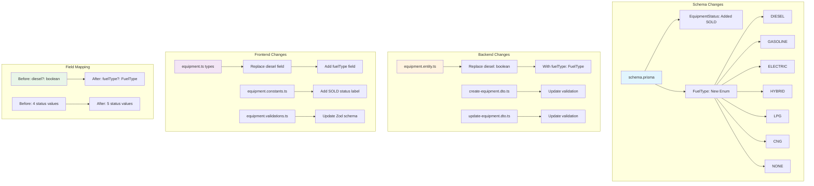

# Equipment Schema Update - Field Mapping



## Change Summary

### 1. Equipment Entity Changes

```typescript
// BEFORE
@ApiProperty({ required: false })
diesel?: boolean;

// AFTER
@ApiProperty({ enum: FuelType })
fuelType?: FuelType;
```

### 2. DTO Changes

```typescript
// BEFORE
@IsBoolean()
@IsOptional()
diesel?: boolean;

// AFTER
@IsEnum(FuelType)
@IsOptional()
fuelType?: FuelType;
```

### 3. Type Changes

```typescript
// BEFORE
diesel?: boolean | null;

// AFTER
fuelType?: FuelType | null;
```

### 4. Validation Changes

```typescript
// BEFORE
diesel: z.boolean().optional(),

// AFTER
fuelType: z.enum([
  "DIESEL", "GASOLINE", "ELECTRIC", "HYBRID", "LPG", "CNG", "NONE"
]).optional(),
```

### 5. Constants Changes

```typescript
// BEFORE
export const equipmentStatusLabels: Record<EquipmentStatus, string> = {
  [EquipmentStatus.ACTIVE]: "Activo",
  [EquipmentStatus.INACTIVE]: "Inactivo",
  [EquipmentStatus.MAINTENANCE]: "En mantenimiento",
  [EquipmentStatus.RETIRED]: "Retirado",
};

// AFTER
export const equipmentStatusLabels: Record<EquipmentStatus, string> = {
  [EquipmentStatus.ACTIVE]: "Activo",
  [EquipmentStatus.INACTIVE]: "Inactivo",
  [EquipmentStatus.MAINTENANCE]: "En mantenimiento",
  [EquipmentStatus.RETIRED]: "Retirado",
  [EquipmentStatus.SOLD]: "Vendido",
};
```
